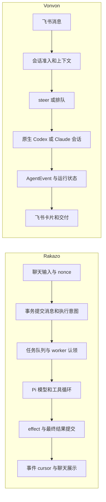

# Rakazo 与 Vonvon：消息、执行和持久状态的架构对照

## 概览

本附件综合产品体验、运行状态和模块复用三份探索。
Rakazo 固定在 `e55263f5fdfee9b2c48680a78e4487d37b4c04a8`；Vonvon 固定在 `bbb329b9a9eef0dd809ee9468e0b6d1b9bf4a769`。
结论来自源码路径，未运行两套产品、模型、飞书或桌面界面；截图和工具描述不作为运行证明。

Rakazo 最值得学习的地方，是把“队友做了什么”变成可查看、可继续、可纠正的产品对象：消息、执行、提问、修改回执、记忆版本和交付物。
Vonvon 已有相近的产品目标，但当前实现的核心仍是飞书输入与原生 Codex/Claude 会话之间的协调，以及运行卡和本地管理。
因此，借鉴重点应落在状态归属、失败语义和用户可核对的结果上，而不是把 Rakazo 的整套执行器搬进来。

两者最大的架构差异是**谁拥有模型与工具循环**。
Rakazo 自己用 Pi 构造模型输入、提供工具、执行工具并保存产品历史；Vonvon 把循环交给原生后端，通过 `AgentThread`/`AgentRun` 接收事件和控制会话。
Rakazo 也有 OAuth 模型配置，差异不能简化成“API key 对订阅”；真正的差异是会话、工具执行和恢复由谁负责。[原生接口][v-types]、[Pi Agent 构造][r-pi]。

| 问题 | Rakazo 当前源码 | Vonvon 当前源码与边界 |
|---|---|---|
| 一条消息由谁收下 | API 事务写消息、run/steering 与事件；clientNonce 支持重放识别 | 飞书消息经会话准入、上下文准备、steer/queue 进入原生线程 |
| 执行由谁持有 | Postgres 条件更新、worker lease/fence、computer lease | 本地运行状态、原生会话独占、后端子进程生命周期 |
| 工具由谁执行 | Pi 调 executor 分发器，执行前后记 effect | Codex/Claude 原生运行时；daemon 仅拥有自己的设置、群等操作 |
| 历史在哪里 | 产品消息/事件数据库，另有可选 Pi JSONL 诊断 | 原生后端会话历史；本地保存 session 绑定、已见标记及运行展示状态 |
| 断线恢复什么 | 从事件 cursor 补产品状态；后台协调器重投可继续 run | 恢复原生 session；对重启丢失的工作有明确通知，不假定任意动作可重放 |
| 提问由谁放行 | 产品 waiting-input 状态与批准后的 effect replay | 按会话 FIFO、真实卡片/请求/点击人核对；权限升级与普通提问分开 |
| 记忆如何持久 | 带来源和 revision 的数据库文档，可导出 Markdown | M7 计划本地、分群/私聊记忆文件及观察、合并、撤销；尚未完成 |
| 用户看到什么 | 自有聊天、Knowledge、交付物等产品页面 | 飞书聊天与卡片；本地网页/桌面主要管理配置和运行 |

## 一条消息如何走完整个系统

### 1. 接收：先区分用户意图、已收消息和正在执行的轮次

Rakazo `sendThreadMessage` 先查 nonce，再事务写消息；根据现有 run 状态选择回答等待中的问题、登记 steering，或建立新的执行。
事务成功以后才通知订阅者和排队；通知失败不抹掉已提交的消息。[接收与提交后通知][r-intake]
Vonvon 则必须适配一个已经在原生后端运行的轮次：先抓住当前 turn 身份，再决定把新消息引导进去还是放到下一轮。
准备图片/上下文期间所有权可能变化，所以调用后还要复查；steer 确认超时只说明结果未知，不说明消息没送达。[Vonvon 准入与引导][v-intake]
这条行为已经很成熟，不应被通用“网络错误就重试”逻辑替换。

### 2. 执行：排队成功不等于获得执行权

Rakazo 的 job 唤醒 executor，executor 以条件更新认领 run，并记录新 fence；过期 worker 即使还活着，也不能合法提交旧轮最终结果。
computer lease 是另一层资源归属；模型打开前还会再核对一次 run 状态，避免停止发生在准备阶段却仍启动模型。[执行认领][r-lease]
Vonvon 的 `AgentThread` 已提供 run、goal、steer、abort、compact 和 close；daemon 不应再叠加一个 Pi 工具循环。
原生 `/goal` 自己连续启动轮次，也不能等同于 Rakazo 的数据库后台任务或定时 routine。[Vonvon goal 与原生会话][v-types]

### 3. 中途：文本、工具、提问与最终结果有不同含义

Rakazo 把工具调用前后的叙述与最终回答区分；工具做完却没有回答时，可继续模型循环或报告缺失，避免把“正在做”当成“做完了”。[Pi 完成判定][r-pi-final]
Vonvon 已把归一化事件折叠进 `RunState`，再由带合并与节流的卡片泵更新飞书；这里的身份是原生 thread/turn/item，不是数据库 event seq。[状态归约][v-reducer]、[卡片泵][v-pump]
两者都需要清晰的终态，但累计文本归约器不能直接替换按 item 更新的归约器；Rakazo 的 ASCII 句末识别也不能无修改用于中文卡片。
提问更不能按“最后看到的卡片”选中：Vonvon 现有协调器先核对真实请求与权限，再同步释放等待，最后做网络呈现。[提问收尾][v-ask]

### 4. 外部动作：记录执行意图，不伪造执行结果

Rakazo 的 effect 记录区分预定、执行中和完成，并用运行、工具、参数及本次出现次数构造标识。
重复相同参数不一定是同一操作；重启后换了模型 tool-call id 也不一定是新操作。已有结果可返回，结果不确定则要求先核对目的地。[effect 标识][r-effect-key]、[effect 记录与不确定结果][r-effect]
这是 Vonvon 自己负责的建群、绑定、发送或设置操作可以借鉴的语义。
它不能替 daemon 看见原生后端内部所有工具，也不能把一个参数哈希变成“恰好执行一次”的保证。

### 5. 停止：撤销本地等待、停止工作、保留未知结果

Rakazo 的停止事务写 cancelled 和终态事件，并先保存要清理的 computer 坐标；之后再做外部清理。[停止路径][r-stop]
Pi 的自定义 iterator 在 `return()` 时立即 abort，随后才等待 generator 退出，避免卡在尚未返回的 `next()`。[立即中止 iterator][r-pi-abort]
Vonvon 已有同类原生流隔离和子进程清理约束；值得迁移的是“静默流、迟到事件、停止时提问、父子轮交错”等测试场景，而不是多加一层关闭包装。
“停止按钮已接受”“进程已退出”“外部动作未发生”必须保持三种不同结论。

### 6. 完成与重连：恢复展示不等于重新执行

Rakazo 的最终提交核对 owner/fence，数据库事件按线程分配递增序号，订阅者从 cursor 补读；realtime 只是提醒有新数据。[最终提交与事件补读][r-events]
Vonvon 的原生 session 恢复、本地会话绑定和重启丢失通知是另一种明确契约。[session 元数据][v-session]、[丢失工作通知][v-dropped]
若未来本地控制台需要重连补展示，可引入版本化快照或事件游标；不要为了重画一张卡，自动重跑可能已产生副作用的任务。

## 值得学习的边界

**修改回执由存储事实产生。** Rakazo 的指令修改保存 before/after、原因和撤销版本，Knowledge 页面可以读回编辑/导出记忆。
Vonvon M7/M9 已规划相似体验，应让“改了什么、影响谁、何时生效、撤销哪一版”来自 daemon 的提交结果，而不是模型措辞。[指令修改][r-instructions]、[Vonvon M7][v-plan]
借鉴回执不意味着引入所有设置变更的统一审批；Vonvon 的授权私聊修改、群内禁止改设置和越权拒绝仍是产品边界。

**上下文需要来源、预算和原文退路。** Rakazo 记忆注入限字节，历史摘要带序号，使用摘要时检查后续序列是否连续；精确历史工具结果不按普通工具输出随意压缩。[历史选择][r-history]、[记忆预算][r-memory]
Vonvon s48 可以借鉴分页边界、后续纠正、原文不可用和越权读取的验证场景，但仍按同 bot、同群及权限档限定可读会话。
Rakazo 的 user/space 不是飞书群的隐私边界；数据库 revision 也不能直接解决多个原生 agent 同时改记忆文件。

**短期子 agent 与长期 bot 分开。** Rakazo 的 Pi helper 有并发与嵌套限制；`message_bot` 则有独立收件人、跳数和交付去重。[子 agent][r-subagent]、[持久 bot 消息][r-peer]
Vonvon s34/s35 应接原生子线程和逐个停止；s27 是飞书可见的 bot 协作。自动创建新飞书 bot、私下跨 bot 通信不能顺带引入。
展示上可借鉴每个子 agent 的最近进度和明确终态；保留 Vonvon 已定的最近五步，而非照搬网页组件的数量。

**测试运行链路，另测模型质量。** Rakazo model emulator 在真实 HTTP/SSE 边界注入断流、错误和等待，并检查全部预期步骤都被消费。[模型模拟器][r-emulator]
Vonvon 已有真实 JSON-RPC 加假可执行文件的测试；可补整条 transport → coordinator → reducer → 假卡片出口的断言，继续保留原生协议身份。[现有隔离测试][v-fixture]
这类离线通过证明实现处理了给定事件，不证明模型会选对动作、真实飞书显示正确或 Mac 权限有效。

## 不能混为一谈的机制

| 容易混淆的说法 | 必须保留的区别 |
|---|---|
| “有沙箱” | 文件路径检查、`shell:false`、容器和 OS 读写/网络限制是不同边界；Rakazo desktop 的 host spawn 不是 Vonvon 权限档的替代证明 |
| “记住了” | 会话摘要、可检索历史、长期记忆和 persona 指令各有来源与生命周期；清聊天不自动等于删长期记忆 |
| “能恢复” | 补消息展示、重开模型轮次、重放外部动作需要不同证据；fence 不会撤销已经发生的外部效果 |
| “能复用一个包” | 少量纯函数可提取；core 整包包含 contracts、图表、cron、Markdown 等依赖；testkit 另依赖 adapters、db 和 PostgreSQL testcontainers，间接带入运行时栈 |
| “文件已交付” | 文件可读且存储成功不代表内容正确、HTML 渲染正确或浏览器隔离安全 |
| “任务会自己继续” | 原生 goal、一次后台 run、定时 routine、持久 peer bot 不是同一产品能力 |

Vonvon Codex 适配器在缺乏所需读取隔离的平台上会拒绝 qa/write，而不是静默降级；这一点不能被更方便的 host 执行器削弱。[权限失败关闭][v-sandbox]
Rakazo HTML CSP helper 本身也声明只是第二层，必须有 iframe/WebView 隔离；不能把字符串模板直接放进不受限 Electron 页面。[HTML 边界][r-html]

## 对产品顺序的含义

Rakazo 的体验启发，是让用户尽早经历“一个有稳定个性的队友，完成了一件实际有用的事”。
Vonvon 可以讨论在必要目录/profile/记忆基础后，把一个完整的基础管理员私聊与 persona 场景提前，而非等待全部 M8/M9 界面完成。
这需要比较两种真实方案：先补齐记忆保护后提前抽出 s49，或明确修改范围，先提供不承诺长期记忆的基础私聊。
后一种会产生临时行为和迁移责任，不能用演示速度掩盖；授权、会话隔离、权限档及停止/排队仍是硬依赖。
再考虑把 persona/规矩的授权修改回执从全部技能/MCP 设置中拆出；让可用能力来自真实清单，避免聊天承诺尚未支持的设置。
可选本地聊天、定时任务和版本化交付物库属于新的产品选择，需要先确认用户痛点，不因 Rakazo 已有就自动进入 v1。
现有 s49 仍依赖 s37/s36/s38/s40/e10，s54 依赖 s47/s49/s43/s44，s56 依赖 s54/s55；提前体验必须补齐依赖或另行批准较薄的契约。
这些是顺序与范围的讨论建议，本研究没有改变已批准产品计划。

## 证据与验证限制

三份探索都没有运行上游产品或推理模型；源码测试存在不等于测试通过。
Root 另报告八项无服务纯源码探针通过，覆盖参数规范化、重复出现标识、@everyone/默认目标和提问选择；它们不验证授权、完整执行恢复或界面体验。
尤其不要搬入 Rakazo 的 @everyone 唤醒所有成员、无目标时取第一人的规则：Vonvon 的飞书群策略不同。
上游历史评测文档保留了后续 53/54 的失败资格记录，并明确未捕获失败的实际出站 payload；不能把它说成我们复现了当前 HEAD 缺陷，也不能把早期成本记录当实测收益。[上游验证限制][r-verification]
下一轮优先跑不接 provider 的协议/文件边界场景；真实模型、飞书和 Mac 专属验收仍分别执行。
源码复用前保留固定提交与原文件来源，核对许可和依赖；本附件不构成整个仓库、素材或外部服务的许可背书。

[v-types]: https://github.com/modelzen/vonvon-bot/blob/bbb329b9a9eef0dd809ee9468e0b6d1b9bf4a769/packages/daemon/src/agent/types.ts#L246
[r-pi]: https://github.com/elie222/rakazo/blob/e55263f5fdfee9b2c48680a78e4487d37b4c04a8/packages/adapters/src/pi-runtime.ts#L401
[r-intake]: https://github.com/elie222/rakazo/blob/e55263f5fdfee9b2c48680a78e4487d37b4c04a8/apps/api/src/thread-target.ts#L612
[v-intake]: https://github.com/modelzen/vonvon-bot/blob/bbb329b9a9eef0dd809ee9468e0b6d1b9bf4a769/packages/daemon/src/bot/handle-message.ts#L2036
[r-lease]: https://github.com/elie222/rakazo/blob/e55263f5fdfee9b2c48680a78e4487d37b4c04a8/packages/adapters/src/executor.ts#L3432
[r-pi-final]: https://github.com/elie222/rakazo/blob/e55263f5fdfee9b2c48680a78e4487d37b4c04a8/packages/adapters/src/pi-runtime.ts#L512
[v-reducer]: https://github.com/modelzen/vonvon-bot/blob/bbb329b9a9eef0dd809ee9468e0b6d1b9bf4a769/packages/daemon/src/card/run-state.ts#L127
[v-pump]: https://github.com/modelzen/vonvon-bot/blob/bbb329b9a9eef0dd809ee9468e0b6d1b9bf4a769/packages/daemon/src/card/run-card-stream.ts#L24
[v-ask]: https://github.com/modelzen/vonvon-bot/blob/bbb329b9a9eef0dd809ee9468e0b6d1b9bf4a769/packages/daemon/src/bot/ask-coordinator.ts#L156
[r-effect-key]: https://github.com/elie222/rakazo/blob/e55263f5fdfee9b2c48680a78e4487d37b4c04a8/packages/core/src/approval-effect-key.ts#L7
[r-effect]: https://github.com/elie222/rakazo/blob/e55263f5fdfee9b2c48680a78e4487d37b4c04a8/packages/adapters/src/executor.ts#L8786
[r-stop]: https://github.com/elie222/rakazo/blob/e55263f5fdfee9b2c48680a78e4487d37b4c04a8/apps/api/src/thread-target.ts#L1090
[r-pi-abort]: https://github.com/elie222/rakazo/blob/e55263f5fdfee9b2c48680a78e4487d37b4c04a8/packages/adapters/src/pi-runtime.ts#L194
[r-events]: https://github.com/elie222/rakazo/blob/e55263f5fdfee9b2c48680a78e4487d37b4c04a8/packages/db/src/events.ts#L1220
[v-session]: https://github.com/modelzen/vonvon-bot/blob/bbb329b9a9eef0dd809ee9468e0b6d1b9bf4a769/packages/daemon/src/bot/session-store.ts#L11
[v-dropped]: https://github.com/modelzen/vonvon-bot/blob/bbb329b9a9eef0dd809ee9468e0b6d1b9bf4a769/packages/daemon/src/bot/restart-dropped.ts#L74
[r-instructions]: https://github.com/elie222/rakazo/blob/e55263f5fdfee9b2c48680a78e4487d37b4c04a8/packages/adapters/src/executor.ts#L6361
[v-plan]: https://github.com/modelzen/vonvon-bot/blob/bbb329b9a9eef0dd809ee9468e0b6d1b9bf4a769/docs/v1-plan.md#L840
[r-history]: https://github.com/elie222/rakazo/blob/e55263f5fdfee9b2c48680a78e4487d37b4c04a8/packages/adapters/src/history-compaction.ts#L63
[r-memory]: https://github.com/elie222/rakazo/blob/e55263f5fdfee9b2c48680a78e4487d37b4c04a8/packages/adapters/src/memory-context.ts#L3
[r-subagent]: https://github.com/elie222/rakazo/blob/e55263f5fdfee9b2c48680a78e4487d37b4c04a8/packages/adapters/src/pi-runtime.ts#L1336
[r-peer]: https://github.com/elie222/rakazo/blob/e55263f5fdfee9b2c48680a78e4487d37b4c04a8/packages/adapters/src/bot-messages.ts#L65
[r-emulator]: https://github.com/elie222/rakazo/blob/e55263f5fdfee9b2c48680a78e4487d37b4c04a8/packages/testkit/src/model-emulator.ts#L18
[v-fixture]: https://github.com/modelzen/vonvon-bot/blob/bbb329b9a9eef0dd809ee9468e0b6d1b9bf4a769/packages/daemon/test/turn-stream-isolation.test.ts#L10
[v-sandbox]: https://github.com/modelzen/vonvon-bot/blob/bbb329b9a9eef0dd809ee9468e0b6d1b9bf4a769/packages/daemon/src/agent/codex-appserver/backend.ts#L39
[r-html]: https://github.com/elie222/rakazo/blob/e55263f5fdfee9b2c48680a78e4487d37b4c04a8/packages/core/src/artifact-sandbox.ts#L1
[r-verification]: https://github.com/elie222/rakazo/blob/e55263f5fdfee9b2c48680a78e4487d37b4c04a8/docs/agent-verification.md#L338

## 核实记录

核实记录（2026-10-17）：独立 gpt-6-astra 核对了 API/worker/Pi 与原生后端两条主路径，抽查 lease/fence、停止先中止、effect 身份和 file/DB 记忆边界。图仅表示主流程，外部效果不在数据库原子事务内；没有据源码推导恰好执行一次或 OS 沙箱保证。八项纯函数探针独立复跑通过，完整运行链路未运行。
